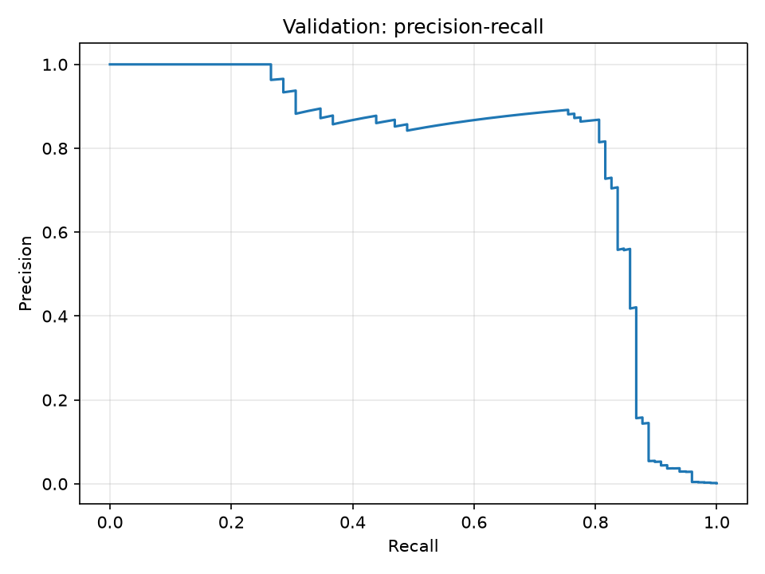
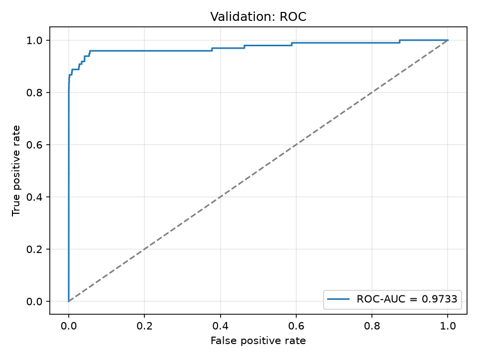

# ЛР2

Модель:

```text
X -> Linear(29, 32) -> ReLU -> Linear(32, 1)
```

Усі команди виконуємо з кореня репозиторію.

Встановлення залежностей та аналіз збережених прогнозів без CSV і тренування:

```bash
uv sync --locked

uv run python lab2/analyze.py --saved lab2/results
```

Для повторного тренування завантажуємо `creditcard.csv` з [Kaggle](https://www.kaggle.com/datasets/mlg-ulb/creditcardfraud)
у `lab2/`. Нова директорія результатів `lab2/results_new` має бути порожньою або ще не існувати:

```bash
uv run python lab2/lab2_starter.py --data lab2/creditcard.csv --out lab2/results_new

uv run python lab2/analyze.py --saved lab2/results_new
```

Результати звіту отримані з `lab2/results/`.

## Датасет і поділ

Ділимо датасет 60/20/20 із приблизно однаковою часткою шахрайства та `random_state=0`:

| Частина    | Транзакцій | Шахрайських | Частка шахрайства |
| ---------- | ---------: | ----------: | ----------------: |
| Train      |     170884 |         295 |           0.1726% |
| Validation |      56961 |          98 |           0.1720% |
| Test       |      56962 |          99 |           0.1738% |

Параметри `StandardScaler` обчислюємо на train, щоб масштаб всієї вибірки (разом із validation і test) не витікли на тренування. Тренуємо модель 12 епох на CPU.

## Рішення моделі та вартість помилок

Для кожної транзакції модель повертає score s від 0 до 1.
Прогнозуємо шахрайство за порога t, якщо:

$$
s_i \ge t
$$

Вартість помилок:

$$
C(t) = 10 \cdot FN(t) + FP(t)
$$

## Вибір порога на validation

Перевіряємо як поріг кожне різне значення s на validation та +∞.
Сортуємо транзакції за s від найбільшого до найменшого й за один прохід рахуємо TP та FP для всіх порогів.
Обираємо поріг із найменшою вартістю помилок. Якщо таких порогів кілька, беремо найбільший.

| Правило           |  Поріг t |  TP |  FP |  FN |    TN |   C |
| ----------------- | -------: | --: | --: | --: | ----: | --: |
| Стандартний поріг |      0.5 |  71 |   9 |  27 | 56854 | 279 |
| Мінімум вартості  | 0.031194 |  82 |  34 |  16 | 56829 | 194 |
| Усі звичайні      |       +∞ |   0 |   0 |  98 | 56863 | 980 |

Точний поріг:

$$
t^* = 0.031193915754556656
$$

Усі перевірені пороги: [threshold_candidates.csv](results/analysis/threshold_candidates.csv).

ROC-AUC на validation: 0.973318.





## Перевірка пошуку

Незалежний перебір усіх порогів дав ті самі TP, FP, FN, TN, вартість та обрані пороги.

### Датасет A

| Поріг t |  TP |  FP |  FN |  TN |   C |
| ------: | --: | --: | --: | --: | --: |
|      +∞ |   0 |   0 |   2 |   4 |  20 |
|     0.9 |   0 |   1 |   2 |   3 |  21 |
|     0.7 |   1 |   2 |   1 |   2 |  12 |
|     0.4 |   2 |   2 |   0 |   2 |   2 |
|     0.2 |   2 |   3 |   0 |   1 |   3 |
|     0.1 |   2 |   4 |   0 |   0 |   4 |

Обраний поріг 0.4. Перевіряємо, що швидкий пошук врахував усі транзакції з однаковим s.

### Датасет B

| Поріг t |  TP |  FP |  FN |  TN |   C |
| ------: | --: | --: | --: | --: | --: |
|      +∞ |   0 |   0 |   0 |   3 |   0 |
|     0.9 |   0 |   1 |   0 |   2 |   1 |
|     0.6 |   0 |   2 |   0 |   1 |   2 |
|     0.3 |   0 |   3 |   0 |   0 |   3 |

Обраний поріг +∞. Перевіряємо випадок без шахрайства, коли всі тривоги хибні.

### Датасет C

| Поріг t |  TP |  FP |  FN |  TN |   C |
| ------: | --: | --: | --: | --: | --: |
|      +∞ |   0 |   0 |   2 |  11 |  20 |
|     0.8 |   1 |   0 |   1 |  11 |  10 |
|     0.5 |   2 |  10 |   0 |   1 |  10 |
|     0.2 |   2 |  11 |   0 |   0 |  11 |

За порогів 0.8 і 0.5 вартість однакова, 10. Обрано більший поріг 0.8.

## Результати на test

До test застосовуємо поріг із validation без змін.

| Справжній клас         | Прогноз 0 | Прогноз 1 |
| ---------------------- | --------: | --------: |
| 0, звичайна транзакція | TN: 56820 |    FP: 43 |
| 1, шахрайство          |    FN: 19 |    TP: 80 |

$$
\mathrm{precision} = \frac{TP}{TP + FP} = \frac{80}{123} \approx 0.650407
$$

$$
\mathrm{recall} = \frac{TP}{TP + FN} = \frac{80}{99} \approx 0.808081
$$

Вартість помилок на test: 233.

## Приклади помилок

Перші п'ять FP і п'ять FN за номером рядка CSV від нуля, без заголовка. `Amount` взято з CSV.

| Рядок CSV | Помилка | Лейбл |  Score s | Amount | Відстань до порога |
| --------: | ------- | ----: | -------: | -----: | -----------------: |
|       460 | FP      |     0 | 0.196159 |   2.00 |           0.164965 |
|      2961 | FP      |     0 | 0.080961 |   2.49 |           0.049767 |
|     10783 | FP      |     0 | 0.966327 |  89.99 |           0.935133 |
|     13405 | FP      |     0 | 0.932032 |  89.99 |           0.900838 |
|     13617 | FP      |     0 | 0.922762 |  89.99 |           0.891568 |
|     10497 | FN      |     1 | 0.011464 |   3.79 |           0.019730 |
|     52521 | FN      |     1 | 0.006373 | 105.99 |           0.024821 |
|     55401 | FN      |     1 | 0.005642 |   1.00 |           0.025552 |
|     91671 | FN      |     1 | 0.000500 | 290.18 |           0.030693 |
|     93486 | FN      |     1 | 0.018352 |   0.00 |           0.012842 |

Серед наведених FP суми від 2.00 до 89.99, серед FN від 0.00 до 290.18.
Ці FN ближчі до порога, ніж FP. За десятьма прикладами не можна визначити причини помилок моделі.

## Висновок

На validation порівняли стандартний поріг 0.5 з обраним порогом із таблиці вище.
Кількість пропущених шахрайських транзакцій FN зменшилася з 27 до 16, а хибних тривог FP зросла з 9 до 34.
Вартість помилок зменшилася з 279 до 194.

Поріг обрано за мінімальною вартістю на validation. На test інші транзакції, тому такий самий виграш не гарантований.

## Джерела

- Код тренування взято з `lab2_starter.py`.
- Код аналізу зроблено за допомогою Codex.
