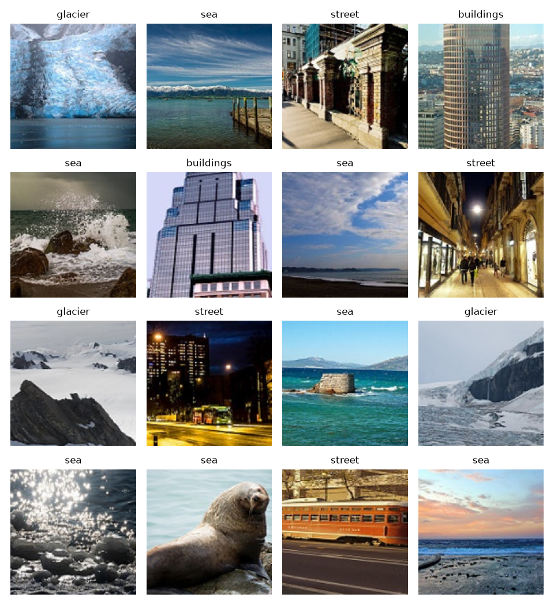
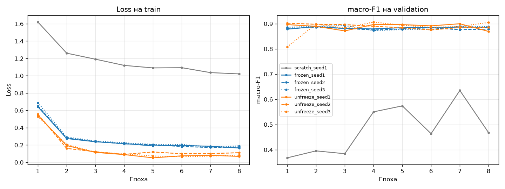
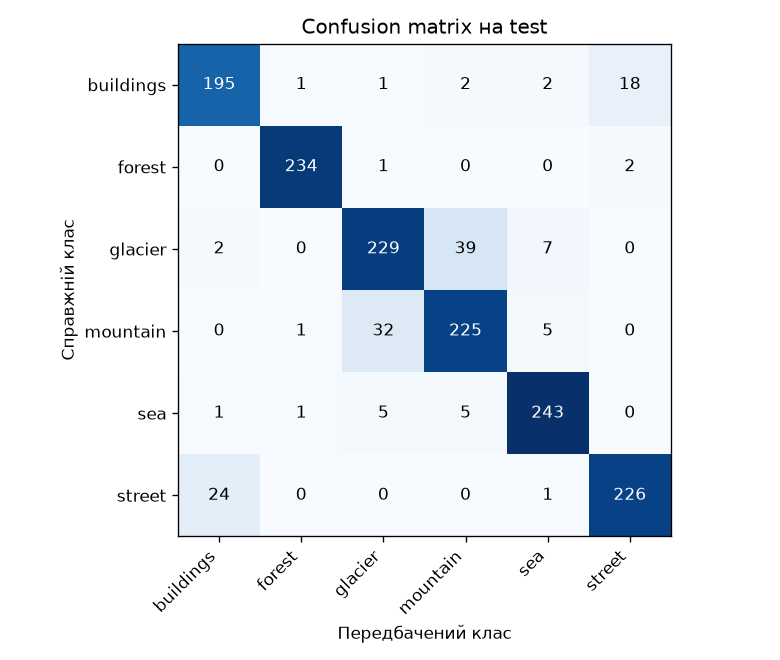
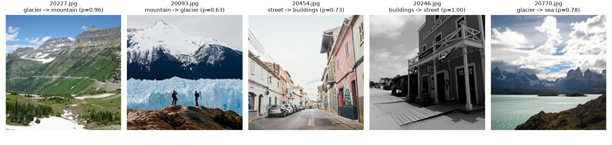

# ЛР3

Задача порівняти способи навчити ResNet-18 розпізнавати 6 класів картинок, маючи лише 200 фото на клас.

ResNet-18 складається з двох частин:

- **backbone** (`conv1`, `bn1`, `layer1`-`layer4`) перетворює картинку на 512 фіч (свого роду енкодер);
- **голова** (`fc`) за фічами вибирає один із 6 класів.

| Режим      | Ваги backbone | Що навчається                       | Що заморожено (у `eval()` під час навчання) |
| ---------- | ------------- | ----------------------------------- | ------------------------------------------- |
| `scratch`  | випадкові     | уся мережа, lr 3e-3                 | нічого                                      |
| `frozen`   | ImageNet      | лише `fc`, lr 3e-3                  | `conv1`, `bn1`, `layer1`-`layer4`           |
| `unfreeze` | ImageNet      | `fc` (lr 3e-3) і `layer4` (lr 3e-4) | `conv1`, `bn1`, `layer1`-`layer3`           |

Бюджет однаковий для кожного 8 епох по 38 кроків.

## Запуск

Усі команди виконуємо з кореня репозиторію.

```bash
uv sync --locked
```

Датасет завантажується з Kaggle:

```bash
mkdir -p lab3/data && curl -L -o lab3/data/archive.zip https://www.kaggle.com/api/v1/datasets/download/puneet6060/intel-image-classification && unzip -q lab3/data/archive.zip -d lab3/data && rm lab3/data/archive.zip
```

Навчання: спліт, перевірки пунктів 1-2, сім запусків, вибір `lab3_model.pt`. Test тут не використовується.

```bash
uv run python lab3/train.py --data lab3/data
```

Аналіз: перевірка хешу `split.csv`, таблиця, криві, ефекти, перевірка вибору, а потім одноразовий test, confusion matrix і п'ять помилок.

```bash
uv run python lab3/analyze.py --data lab3/data
```

Структура:

- код: `common.py` (дані, модель, режими, навчання), `checks.py` (перевірки), `train.py`, `analyze.py`;
- `split.csv` - спліт;
- `runs/<режим>_seed<seed>/` - `run.json` (лог) і `val_logits.npy` для кожного з семи запусків. Ваги запусків лишаються лише локально;
- `lab3_model.pt` - вибрані ваги;
- `figures/` - графіки й картинки

## 1. Перевірки до навчання

### Спліт

Кількість / сума числових імен файлів. Усі 18 клітинок збігаються з контрольною таблицею, жоден файл не входить у дві частини.

| Клас      | train           | validation      | test            |
| --------- | --------------- | --------------- | --------------- |
| buildings | 200 / 1996761   | 218 / 4837323   | 219 / 4837559   |
| forest    | 200 / 2032625   | 237 / 5276962   | 237 / 5291326   |
| glacier   | 200 / 2183923   | 276 / 6135652   | 277 / 6157250   |
| mountain  | 200 / 1950345   | 262 / 5789535   | 263 / 5849765   |
| sea       | 200 / 1987613   | 255 / 5655068   | 255 / 5668011   |
| street    | 200 / 1841817   | 250 / 5541845   | 251 / 5547533   |
| Разом     | 1200 / 11993084 | 1498 / 33236385 | 1502 / 33351444 |

SHA256 `split.csv`: `148dad92de9a18670c177df9f8757aa6519fb0ea6d74a8ba723cfc4453f0a1bc`.

### Батч після трансформацій

Перші 16 картинок навчального батча, деякі випадково обрізані, іноді віддзеркалені й розтягнуті до 160x160. Нормалізацію перед малюванням прибрали, інакше кольори були б зіпсовані.



### Початковий loss L0

| Режим   |     L0 |
| ------- | -----: |
| scratch | 2.0479 |
| frozen  | 1.9244 |

Модель, яка дає всім класам однакову ймовірність, мала б loss ln 6 = 1.7918. Наш трохи вищий, бо випадкова голова `fc` уже навмання віддає перевагу якимось класам, тому це нормально.

## 2. Перевірка режимів

### Параметри

| Режим    |   Усього | `requires_grad=True` | Групи AdamW                                 |
| -------- | -------: | -------------------: | ------------------------------------------- |
| scratch  | 11179590 |             11179590 | усі: 11179590, lr 3e-3                      |
| frozen   | 11179590 |                 3078 | fc: 3078, lr 3e-3                           |
| unfreeze | 11179590 |              8396806 | fc: 3078, lr 3e-3; layer4: 8393728, lr 3e-4 |

Параметрів із `requires_grad=False` в оптимізаторі немає.

### Зміна за 5 кроків

| Режим    | Модуль | Параметри змінилися | Running-статистики BN змінилися |
| -------- | ------ | ------------------- | ------------------------------- |
| frozen   | conv1  | N                   | -                               |
| frozen   | bn1    | N                   | N                               |
| frozen   | layer1 | N                   | N                               |
| frozen   | layer2 | N                   | N                               |
| frozen   | layer3 | N                   | N                               |
| frozen   | layer4 | N                   | N                               |
| frozen   | fc     | Y                   | -                               |
| unfreeze | conv1  | N                   | -                               |
| unfreeze | bn1    | N                   | N                               |
| unfreeze | layer1 | N                   | N                               |
| unfreeze | layer2 | N                   | N                               |
| unfreeze | layer3 | N                   | N                               |
| unfreeze | layer4 | Y                   | Y                               |
| unfreeze | fc     | Y                   | -                               |

### Експеримент із навмисною помилкою

`frozen`, але з `model.train()` замість `set_train_mode`.

| Модуль | Параметри змінилися | Running-статистики BN змінилися |
| ------ | ------------------- | ------------------------------- |
| conv1  | N                   | -                               |
| bn1    | N                   | Y                               |
| layer1 | N                   | Y                               |
| layer2 | N                   | Y                               |
| layer3 | N                   | Y                               |
| layer4 | N                   | Y                               |
| fc     | Y                   | -                               |

У `train()` BatchNorm рахує середнє й std по поточному батчу, а в `eval()` бере готові, одні для всієї мережі.

## 3. Сім запусків

| #   | Режим    | Seed | Loss train, епоха 8 | macro-F1 validation, епоха 8 | Час навчання, с |
| --- | -------- | ---: | ------------------: | ---------------------------: | --------------: |
| 1   | scratch  |    1 |              1.0212 |                       0.4675 |            57.7 |
| 2   | frozen   |    1 |              0.1655 |                       0.8842 |            28.6 |
| 3   | frozen   |    2 |              0.1757 |                       0.8785 |            21.7 |
| 4   | frozen   |    3 |              0.1896 |                       0.8886 |            22.4 |
| 5   | unfreeze |    1 |              0.0685 |                       0.8692 |            29.2 |
| 6   | unfreeze |    2 |              0.1111 |                       0.8855 |            28.2 |
| 7   | unfreeze |    3 |              0.0838 |                       0.9050 |            37.5 |



## 4. Розклад ефектів

$$
\bar F_r = \frac{1}{3}\sum_{s=1}^{3} F_{r,s}, \qquad R_r = \max_s F_{r,s} - \min_s F_{r,s}, \qquad R = \max(R_{\text{frozen}}, R_{\text{unfreeze}})
$$

$$
\Delta_{\text{pre}} = \bar F_{\text{frozen}} - F_{\text{scratch},1}, \qquad \Delta_{\text{unf}} = \bar F_{\text{unfreeze}} - \bar F_{\text{frozen}}
$$

| Величина                      | Значення       |
| ----------------------------- | -------------- |
| scratch                       | 0.4675         |
| frozen: середнє, розмах       | 0.8838, 0.0101 |
| unfreeze: середнє, розмах     | 0.8866, 0.0358 |
| R (більший із розмахів)       | 0.0358         |
| delta_pre = frozen - scratch  | +0.4163        |
| delta_unf = unfreeze - frozen | +0.0028        |

Якщо |delta| <= R, різниця не відрізняється від розкиду, а якщо |delta| > R, ефект вартий перевірки, але не доведений. Тож delta_pre вартий перевірки, а delta_unf не відрізняється від розкиду.

Початкові ваги, порядок батчів і аугментації змінюються сідом, тому у `scratch` від нього залежить уся мережа, у `frozen` лише голова на фіксованих фічах, тому розкид малий (0.010). У `unfreeze` ще й `layer4` з 8.4 млн ваг, тому розкид більший (0.036).

За ті самі 304 кроки `scratch` вчиться 58 с, `unfreeze` близько 32 с, `frozen` близько 24 с.

## 5. Вибір і тест

Беремо ваги із найкращим середнім на validation (`unfreeze`) і в ньому найкращий запуск `unfreeze_seed3`. Його ваги в `lab3_model.pt`.

Перевіряємо цю модель на test:

|            | macro-F1 |
| ---------- | -------: |
| validation |   0.9050 |
| test       |   0.9019 |

Різниця вийшла приблизно 0.003. Але сам test має похибку близько плюс-мінус 0.008 (accuracy p = 0.9001, sqrt(p(1-p)/n) = 0.0077 при n = 1502), тож ця різниця в межах шуму і могла вийти навіть з іншим знаком.

Де модель помиляється на test:



### П'ять характерних помилок

| Файл      | Справжній клас | Передбачений клас | Імовірність передбаченого класу | Кількість таких помилок у test |
| --------- | -------------- | ----------------- | ------------------------------: | -----------------------------: |
| 20227.jpg | glacier        | mountain          |                          0.9564 |                             39 |
| 20093.jpg | mountain       | glacier           |                          0.6273 |                             32 |
| 20454.jpg | street         | buildings         |                          0.7307 |                             24 |
| 20246.jpg | buildings      | street            |                          1.0000 |                             18 |
| 20770.jpg | glacier        | sea               |                          0.7819 |                              7 |



- **20227.jpg:** ймовірно неправильний лейбл, бо це гірська долина без льодовика.
- **20093.jpg:** у кадрі обидва класи, засніжена вершина й льодовик під нею.
- **20454.jpg:** у кадрі обидва класи, вулиця з будинками по боках.
- **20246.jpg:** у кадрі обидва класи, фасад будинку й тротуар.
- **20770.jpg:** ймовірно неправильний лейбл, бо в кадрі озеро й гори без льодовика.

Плутанина glacier - mountain є властивістю датасету, бо гори й льодовики часто на одному кадрі.

## 6. Висновок

- **delta_pre:** ваги ImageNet дають +0.416 macro-F1 (0.468 -> 0.884), це в 11.6 раза більше за R = 0.036.
- **delta_unf:** розморожування `layer4` дає +0.003 (0.884 -> 0.887), це менше за R, тож ефекту не видно.

За довшого навчання `scratch` міг би скоротити відставання, бо його loss ще спадав.

Для нової задачі з 200 фото на клас ми взяли б `frozen`, бо якість як в `unfreeze`, а розкид і час навчання менші.

## Джерела

- Код підготовлено за допомогою Claude Code.
